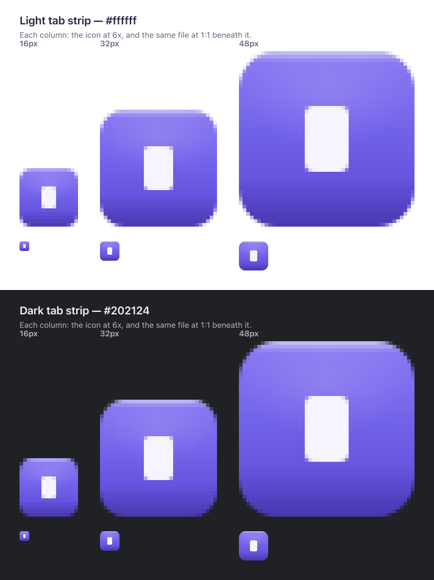
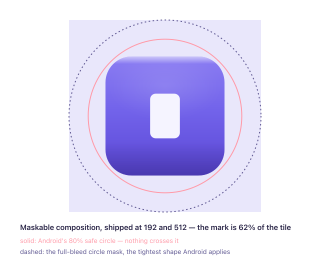
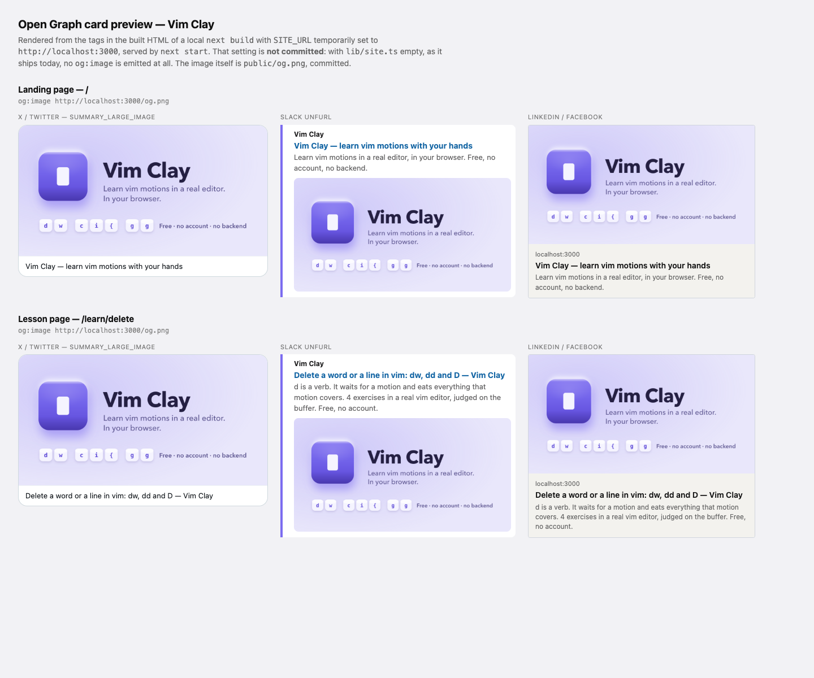

# The icon, and the social card

A claymorphic keycap with vim's block cursor on it as the legend. Both halves are the
site's own — the keycap is `.clay-key` in `app/globals.css` section 7, the block is
`.cm-fat-cursor` in `components/editor/theme.ts` — and nothing else is invented.

Everything under `app/icon.svg`, `app/favicon.ico`, `app/apple-icon.png`,
`public/icons/` and `public/og.png` comes out of one script:

```
node scripts/generate-icons.mjs
```

Edit the geometry and palette at the top of that script, re-run it, and commit what
changes. Do not hand-edit the SVG or the binaries — the next run will overwrite them.
The script's header comment is where the design reasoning lives; the two sheets below
are the evidence for it.

## `tab-strip.png` — it survives 16 pixels, on either ground



`.clay-key`'s dome is a four-layer box-shadow and none of it survives at 16px. The two
outer layers — the drop shadow and the white bounce light — are gone outright, because
they live outside the silhouette and an outside soft radius at this size is a grey
fringe that costs the mark its edge. What is left is a single lit top edge exactly one
device pixel tall, a shade pooling at the foot, and a gentle body gradient. All three
fall _inside_ the shape, so they cost no sharpness at any size.

The two tones split the work across grounds. On white the violet cap carries the
silhouette at 6.3:1 and the pale block reads as a hole punched in it; on a dark strip
the violet falls to about 2.6:1 but the pale block rises to roughly 15:1 and carries the
mark instead. Neither ground is assumed, and the page's pale periwinkle is never leaned
on.

## `maskable-safe-zone.png` — Android cannot crop it



The mark is 62% of the tile on an opaque `--clay-bg` plate. For a rounded square of side
`s` with corner radius `0.219s`, the farthest point from centre is `0.616s`, so the 80%
safe circle caps the mark at `0.649` of the tile; 62% takes that with slack. The corners
stay inside the pink circle, so no launcher shape clips them.

## `og-card.png` — what a share looks like



`public/og.png` is the same mark at 240px with the two outer shadow layers put back —
they were dropped from the favicon because a soft radius outside the silhouette is a grey
fringe at 16 pixels, and at 240 they are the whole point of the material. Beside it the
name, the one-line promise, and a row of at-rest keycaps spelling three real motions.

The lettering is the one thing on it that is not the site's own. Fredoka and JetBrains Mono
arrive through `next/font/google`, which writes them into `.next/static/media` under
content-hashed names at build time — a gitignored build artefact this script cannot name.
So the card is set in the platform's UI sans, written out as an explicit stack rather than
left to `system-ui`. The committed PNG is what ships either way.

**The card is dormant.** `og:image` needs an absolute URL to mean anything to any platform,
so `lib/seo/copy.ts` attaches it only once `lib/site.ts` has an origin. Until then the file
is committed and unreferenced. The sheet above was rendered from a local `next build` with
`SITE_URL` temporarily set to `http://localhost:3000` — it is what a share will look like
the day a domain lands, and nothing else has to change for it.
